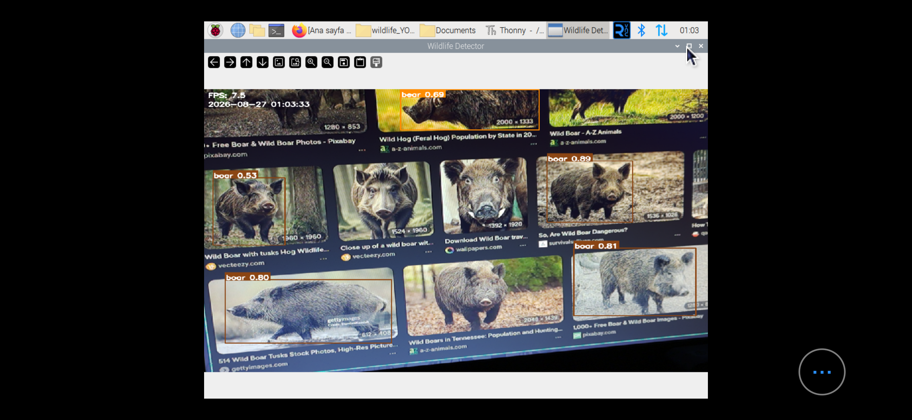
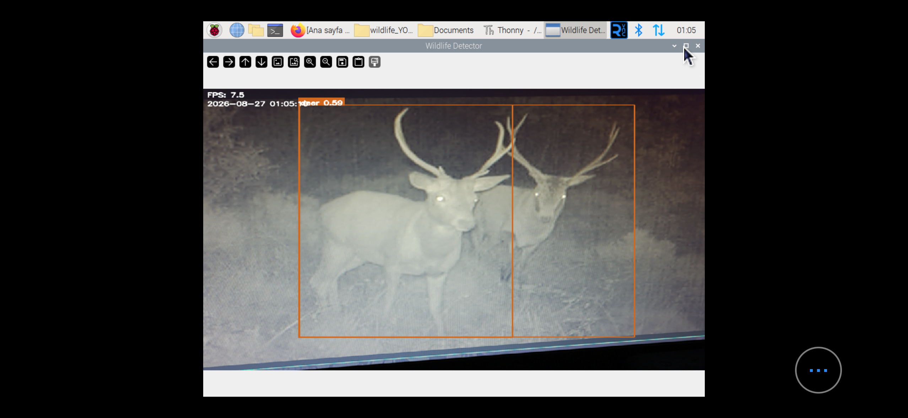
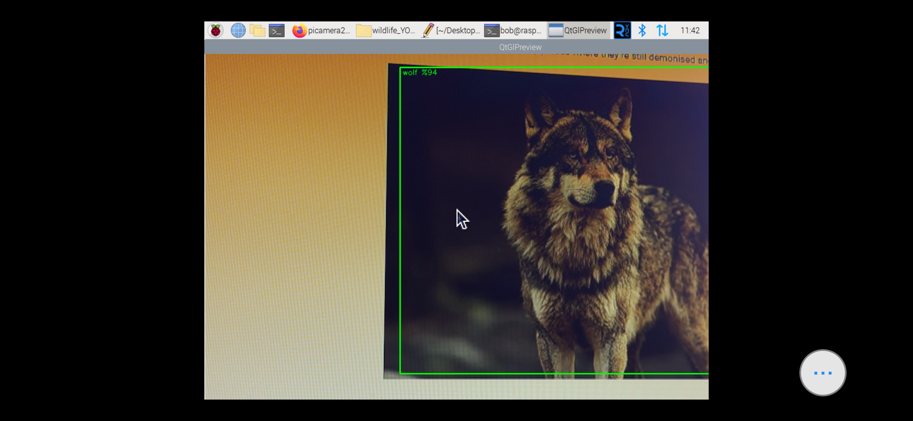
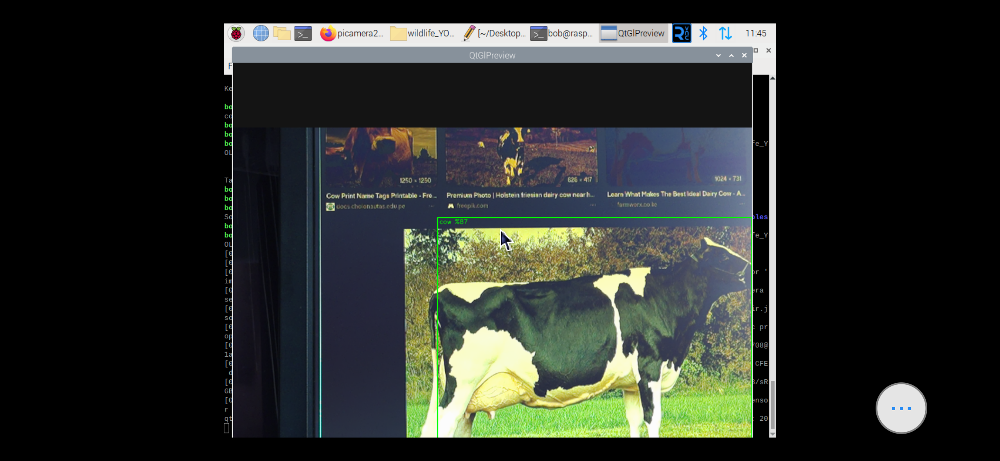

## 👀 wildlife Overview  
A Raspberry Pi and Hailo-8-based smart camera system that uses AI to detect animals and capture photos and videos  











<h1 align="center">webapp</h1>  

  

<details>
<summary>Training Images</summary>
# 🍓 Raspberry Pi 5 ↔ Telefon: USB Hotspot (Tethering) + RealVNC ile Uzaktan Ekran ve Dokunmatik Kontrol

```
                                  (telefon hotspot / USB tethering)
      \  |  /
       \ | /
   .---------.                    .------------------------.
   | .-----. |                    |    RASPBERRY PI 5      |
   | | VNC | |  USB Tethering     |  [VNC Server]          |
   | | App |<==================>  | USB-A <-- telefon      |
   | '-----' |  (internet + VNC)  |                        |
   |   ( )   |                    '-----------+------------'
   '---------'                                |  USB-C 5V/5A
                                      .-------+-------.
                                      |   POWERBANK   |
                                      '---------------'
```

Bu rehber, Raspberry Pi 5'i **powerbank** ile çalıştırıp internetini telefonunuzun **USB hotspot'undan (USB tethering)** almasını, ardından **RealVNC** ile Pi ekranını telefonda görüp dokunarak kontrol etmenizi anlatır.

---

## 📋 İçindekiler

1. [Gereksinimler](#-gereksinimler)
2. [Nasıl Çalışır?](#-nasıl-çalışır)
3. [Adım 1: Pi'yi Hazırla](#adım-1-pi-yi-hazırla)
4. [Adım 2: Powerbank ile Besle](#adım-2-powerbank-ile-besle)
5. [Adım 3: Telefondan USB Tethering](#adım-3-telefondan-usb-tethering)
6. [Adım 4: Pi'de İnterneti Doğrula](#adım-4-pi-de-interneti-doğrula)
7. [Adım 5: Pi'de VNC Server](#adım-5-pi-de-vnc-server)
8. [Adım 6: Telefonda VNC Viewer](#adım-6-telefonda-vnc-viewer)
9. [Adım 7: Dokunmatik Kontrol](#adım-7-dokunmatik-kontrol)
10. [Sorun Giderme](#-sorun-giderme)

---

## 🧰 Gereksinimler

| Parça | Not |
|---|---|
| Raspberry Pi 5 | Raspberry Pi OS (Bookworm, 64-bit) kurulu olmalı |
| Powerbank | **USB-C PD**, mümkünse 5V/5A veya en az 5V/3A çıkışlı |
| USB kablo | Telefona uygun **veri** kablosu (sadece şarj kablosu çalışmaz) |
| Telefon | Android (önerilen) veya iPhone |
| Telefonda | **RealVNC Viewer** uygulaması |
| İlk kurulum için | Monitör + klavye/fare veya SSH erişimi |

> ⚠️ Pi 5'in USB-C portu **sadece güç** içindir. Telefonu Pi'nin **USB-A** portlarından birine bağlayacaksınız.

---

## 🔍 Nasıl Çalışır?

1. Powerbank, Pi 5'i USB-C portundan besler.
2. Telefon, USB kabloyla Pi'ye bağlanır ve **USB Tethering** açılır. Pi telefonu ağ kartı gibi görür ve internetini telefondan alır.
3. Pi'deki **VNC Server** ekran görüntüsünü ağ üzerinden yayınlar.
4. Telefondaki **VNC Viewer**, Pi'nin ekranını gösterir. Parmak hareketleri fare tıklaması ve imleç hareketi olarak Pi'ye iletilir.

---

## Adım 1: Pi'yi Hazırla

İlk kurulumda Pi'yi monitöre bağlayıp ya da SSH ile şunları çalıştırın:

```bash
sudo apt update && sudo apt full-upgrade -y
sudo reboot
```

İsterseniz **Raspberry Pi Imager** ile SD karta yazarken kullanıcı adı, şifre ve SSH ayarlarını önceden yapabilirsiniz.

---

## Adım 2: Powerbank ile Besle

1. Powerbank'i Pi 5'in **USB-C** portuna takın.
2. Pi açılırken "power supply" uyarısı çıkarsa güç yetersizdir. Daha güçlü bir PD powerbank/kablo kullanın.
3. Gerekirse `/boot/firmware/config.txt` dosyasına şunu ekleyebilirsiniz (powerbank gerçekten 5A veriyorsa):

```ini
usb_max_current_enable=1
```

> 💡 Telefon, tethering sırasında Pi'den şarj olmaya çalışabilir ve powerbank'i hızlı tüketebilir. Uzun kullanımda bunu göz önünde bulundurun.

---

## Adım 3: Telefondan USB Tethering

### 🤖 Android

1. Telefonu Pi'nin **USB-A** portuna kabloyla bağlayın.
2. **Ayarlar → Bağlantılar → Mobil Hotspot ve Bağlantı Paylaşımı → USB Tethering** seçeneğini açın.

> ℹ️ Wi-Fi hotspot'u açmak yeterli değildir. Kablolu bağlantı için **USB Tethering** anahtarını açmanız gerekir.

### 🍎 iPhone

1. iPhone'u kabloyla bağlayın, **"Bu Bilgisayara Güven"** deyin.
2. **Ayarlar → Kişisel Hotspot → Diğerlerinin Katılmasına İzin Ver** açık olsun.
3. Pi'de gerekirse:

```bash
sudo apt install -y usbmuxd libimobiledevice6 libimobiledevice-utils
```

---

## Adım 4: Pi'de İnterneti Doğrula

```bash
ip a
```

`usb0` veya `enx...` gibi yeni bir arayüz ve ona atanmış bir IP (ör. `192.168.42.xxx`) görmelisiniz.

```bash
ping -c 3 google.com
hostname -I
```

> 🔧 Pi daha önce kayıtlı bir Wi-Fi'ye bağlanıyorsa trafiği USB üzerinden zorlamak için Wi-Fi'yi kapatın:
> ```bash
> sudo nmcli radio wifi off
> ```

`hostname -I` çıktısındaki USB arayüzünün IP adresini not alın. Bağlanırken lazım olacak.

---

## Adım 5: Pi'de VNC Server

```bash
sudo raspi-config
```

**Interface Options → VNC → Yes**

Ya da tek komutla:

```bash
sudo raspi-config nonint do_vnc 0
sudo systemctl enable --now vncserver-x11-serviced
```

### 🖥️ Monitörsüz (headless) kullanım

Monitör takılı değilse VNC siyah ekran verebilir. Çözümler:

- Bir **HDMI dummy plug** takın, **ya da**
- `sudo raspi-config` → **Display Options → VNC Resolution** ile bir çözünürlük seçin (ör. 1280x720).

### ☁️ (Önerilen) RealVNC hesabı ile Cloud bağlantısı

1. Pi'de sağ üstteki **VNC simgesine** tıklayıp RealVNC hesabınızla **Sign in** yapın.
2. Böylece IP bilmeden, aynı hesapla telefondan bağlanabilirsiniz. Bu yöntem, yerel IP üzerinden bağlantı sorunlarında da kurtarıcıdır.

---

## Adım 6: Telefonda VNC Viewer

1. Telefona **RealVNC Viewer** uygulamasını kurun (Play Store / App Store).
2. **Yöntem A: Doğrudan IP**
   - **+** ile yeni bağlantı oluşturun.
   - Adres: Adım 4'te not ettiğiniz Pi IP'si (ör. `192.168.42.123`)
   - Kullanıcı adı ve şifre: Pi OS kullanıcı bilgileriniz.
3. **Yöntem B: Cloud**
   - Uygulamada aynı RealVNC hesabıyla giriş yapın.
   - Pi listede görünür, dokunup bağlanın.

---

## Adım 7: Dokunmatik Kontrol

VNC Viewer'da (ayarlar/araç çubuğundan) giriş modunu seçebilirsiniz:

| Mod | Davranış |
|---|---|
| **Touchscreen (Dokunmatik)** | Dokunduğunuz yere tıklar |
| **Trackpad (Dokunmatik yüzey)** | Parmakla imleci hareket ettirirsiniz, dokunarak tıklarsınız |

Genel hareketler:

- **Tek dokunuş** → Sol tık
- **Uzun basma** → Sağ tık
- **İki parmakla kaydırma** → Scroll
- **İki parmakla sıkıştırma** → Yakınlaştır/uzaklaştır
- **Klavye simgesi** → Ekran klavyesi ile yazı yazma

---

## 🛠️ Sorun Giderme

| Sorun | Çözüm |
|---|---|
| Pi telefonu görmüyor | Veri destekli kablo kullanın, farklı USB-A portu deneyin |
| `usb0` yok | Telefonda USB Tethering'i kapatıp açın, `dmesg \| tail` ile kontrol edin |
| İnternet var ama VNC IP ile bağlanmıyor | **Cloud** yöntemini kullanın, `systemctl status vncserver-x11-serviced` kontrol edin |
| VNC'de siyah ekran | HDMI dummy plug veya VNC çözünürlüğü ayarlayın (Adım 5) |
| Pi sürekli yeniden başlıyor | Powerbank/kablo yetersiz, 5V/5A PD destekli olanı kullanın |
| IP her seferinde değişiyor | Cloud bağlantı kullanın ya da `hostname -I` ile yeniden bakın |

---

## ✅ Hızlı Özet

```text
1. Powerbank -> Pi 5 (USB-C)
2. Telefon -> Pi 5 (USB-A), USB Tethering AÇIK
3. Pi: ping google.com + hostname -I
4. Pi: VNC Server AÇIK (raspi-config)
5. Telefon: RealVNC Viewer -> IP veya Cloud ile bağlan
6. Touchscreen/Trackpad moduyla kontrol et 🎉
```
</details>

## 🚀 Features

- [x] PIR Mode  
- [x] Continuous Mode  
- [x] Bear / Boar / Deer / Wolf Detection Triggers  
- [x] Photo Capture  
- [x] Video Recording  
- [x] Configurable Video Duration  
- [x] Minimum / Maximum FPS  
- [x] FPS Overlay  
- [x] Raspberry Pi Date / Time Overlay  
- [x] Class-Specific Bounding Box Colors  
- [x] Default Green Bounding Box  
- [x] Multi-Class Image Copying to Relevant Class Folders  
- [x] Live Camera Preview  
- [x] Local Web Configuration Server on Raspberry Pi  
- [x] Autofocus Settings  
- [x] Hailo-8  
- [x] HailoRT 4.20.0  
- [x] yolov11l model  
- [x] 7 classes  
- [x] Hailo NMS  
- [x] Picamera2  
- [x] IMX708 NoIR  
- [x] 1280×960 main  
- [x] 640×640 inference  
- [x] outputs/bear/image  
- [x] outputs/bear/video  
- [x] JSON-Based Configuration Management

## 📦 Setup  
Directory Structure  
~/.config/wildlife_YOLO/  
├── config.json  
├── hailort.log(This file is auto-generated)  
├── labels.txt  
├── wildlife_detector.py  
├── yolov11l.hef  
└── outputs/(This file is auto-generated)  
<br>

```
sudo apt update
sudo apt full-upgrade -y

sudo apt install --reinstall \
    python3-numpy \
    python3-simplejpeg \
    python3-picamera2 \
    python3-gpiozero
```

cd ~/Desktop/wildlife_YOLO  

rm -rf .venv  

python3 -m venv --system-site-packages .venv  
source .venv/bin/activate  

python3 -c "from picamera2 import Picamera2; print('Picamera2 OK')"  
>Picamera2 OK  

python3 -c "import numpy; print('NumPy:', numpy.__version__)"  
>NumPy: 1.24.2  

python3 -c "from gpiozero import MotionSensor; print('gpiozero OK')"  
>gpiozero OK  

python3 -c "from hailo_platform import HEF, VDevice; print('HailoRT Python OK')"  
>hailortcli fw-control identify  

sudo modprobe hailo_pci  

hailortcli parse-hef ~/Desktop/wildlife_YOLO/yolov11l.hef  
>Architecture: HAILO8
>Input: 640x640x3 UINT8
>Classes: 7
>Hailo NMS BY CLASS
>Score threshold: 0.200
>IoU threshold: 0.70

echo hailo_pci | sudo tee /etc/modules-load.d/hailo.conf  

cat ~/Desktop/wildlife_YOLO/labels.txt  
>0 = bear  
>1 = boar  
>2 = deer  
>3 = wolf  
>4 = cow  
>5 = person  
>6 = dog  

## 🎉 Run  
cd ~/Desktop/wildlife_YOLO  
source .venv/bin/activate  
python3 wildlife_detector.py OR python3 wildlife_detector_web.py(for real outworld usage)  


## ❓ HOW IT WORKS ❓  

                    Raspberry Pi Camera
                           │
                           ▼
                      Picamera2
                           │
                           ▼
                         Camera
                           │
              ┌────────────┴────────────┐
              │                         │
          Main stream              Lores stream
          1280×960                  640×640
              │                         │
              │                         ▼
              │                    Hailo-8
              │                         │
              │                   yolov11l.hef
              │                         │
              │                    Hailo NMS
              │                         │
              │                         ▼
              │                  Detections
              │             (class / confidence / bbox)
              │                         │
              └────────────┬────────────┘
                           │
                           ▼
                 wildlife_detector_web.py
                           │
                    ┌──────┴──────┐
                    │             │
                   PIR       Continuous
                    │             │
                    └──────┬──────┘
                           │
                           ▼
                    Target classes
                  Bear / Boar / Deer / Wolf
                           │
                           ▼
                  Confidence threshold
                           │
                           ▼
                 ┌─────────┴─────────┐
                 │                   │
              Image                Video
                 │                   │
                 ▼                   ▼
           outputs/class/       outputs/class/
              image/               video/
