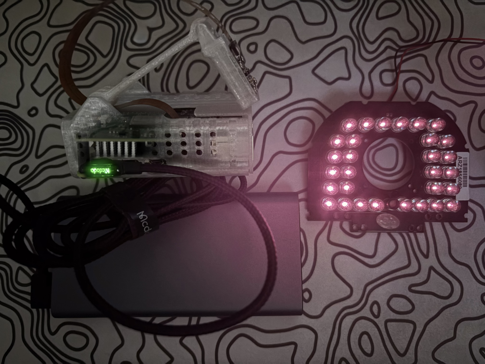
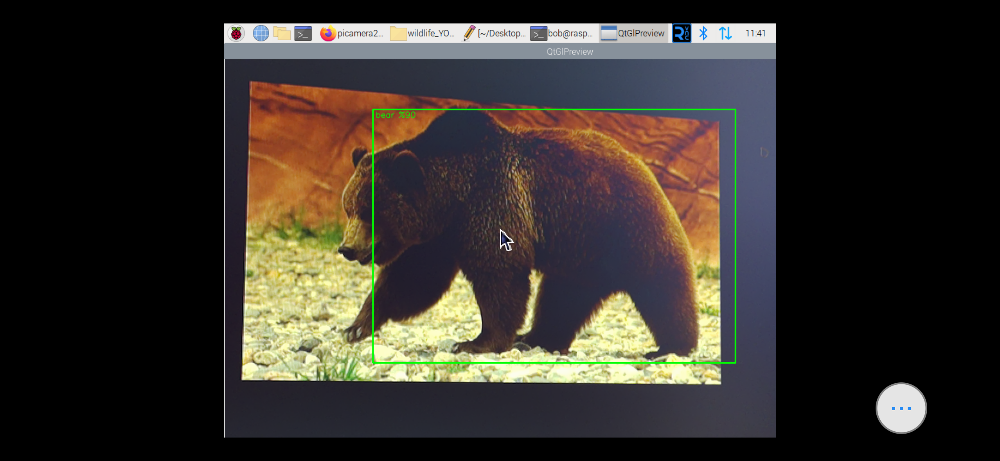
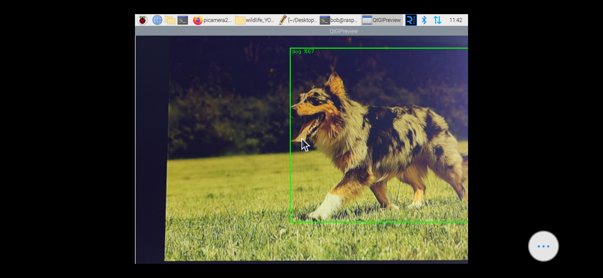
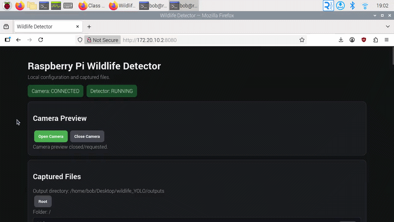

## 👀 wildlife Overview  









<h1 align="center">webapp</h1>  

  

```
sudo apt update
sudo apt full-upgrade -y

sudo apt install --reinstall \
    python3-numpy \
    python3-simplejpeg \
    python3-picamera2 \
    python3-gpiozero
```

cd ~/Desktop/wildlife_YOLO  

rm -rf .venv  

python3 -m venv --system-site-packages .venv  
source .venv/bin/activate  

python3 -c "from picamera2 import Picamera2; print('Picamera2 OK')"  
>Picamera2 OK  

python3 -c "import numpy; print('NumPy:', numpy.__version__)"  
>NumPy: 1.24.2  

python3 -c "from gpiozero import MotionSensor; print('gpiozero OK')"  
>gpiozero OK  

python3 -c "from hailo_platform import HEF, VDevice; print('HailoRT Python OK')"  
>hailortcli fw-control identify  

hailortcli parse-hef ~/Desktop/wildlife_YOLO/yolov11l.hef  
>Architecture: HAILO8
>Input: 640x640x3 UINT8
>Classes: 7
>Hailo NMS BY CLASS
>Score threshold: 0.200
>IoU threshold: 0.70

echo hailo_pci | sudo tee /etc/modules-load.d/hailo.conf  

cat ~/Desktop/wildlife_YOLO/labels.txt  
0 = bear  
1 = boar  
2 = deer  
3 = wolf  
4 = cow  
5 = person  
6 = dog  

RUN  
cd ~/Desktop/wildlife_YOLO  
source .venv/bin/activate  
python3 wildlife_detector.py OR python3 wildlife_detector_web.py(for real outworld usage)  


                    Raspberry Pi Camera
                           │
                           ▼
                      Picamera2
                           │
                           ▼
                         Camera
                           │
              ┌────────────┴────────────┐
              │                         │
          Main stream              Lores stream
          1280×960                  640×640
              │                         │
              │                         ▼
              │                    Hailo-8
              │                         │
              │                   yolov11l.hef
              │                         │
              │                    Hailo NMS
              │                         │
              │                         ▼
              │                  Detections
              │             (class / confidence / bbox)
              │                         │
              └────────────┬────────────┘
                           │
                           ▼
                 wildlife_detector_web.py
                           │
                    ┌──────┴──────┐
                    │             │
                   PIR       Continuous
                    │             │
                    └──────┬──────┘
                           │
                           ▼
                    Target classes
                  Bear / Boar / Deer / Wolf
                           │
                           ▼
                  Confidence threshold
                           │
                           ▼
                 ┌─────────┴─────────┐
                 │                   │
              Image                Video
                 │                   │
                 ▼                   ▼
           outputs/class/       outputs/class/
              image/               video/


config.json  
hailort.log(otomatik olusturulur)  
labels.txt  
wildlife_detector.py  
yolov11l.hef  
outputs/(otomatik olusturulu)  


Features  
PIR modu  
Continuous modu  
Bear / Boar / Deer / Wolf tetikleme  
Fotoğraf çekme  
Video keydetme  
Video süresi  
FPS min/max  
FPS overlay  
Raspberry Pi tarih/saat overlay  
Class'a özel bounding-box renkleri  
Default yeşil bounding-box  
Tespit edilen birden fazla class için aynı görüntüyü ilgili class klasörlerine kopyalama  
Canlı kamera preview  
Raspberry Pi üzerinde local web configuration server  
Autofocus ayarları  
outputs/bear/image  
outputs/bear/video  
Canlı kamera preview  
JSON'dan ayar yönetimi  


Hailo-8              ✅  
HailoRT 4.20.0       ✅  
yolov11l.hef         ✅  
7 classes            ✅  
Hailo NMS            ✅  
labels.txt           ✅  
Picamera2            ✅  
IMX708 NoIR          ✅  
1280×960 main        ✅  
640×640 inference    ✅  
Autofocus            ✅  
